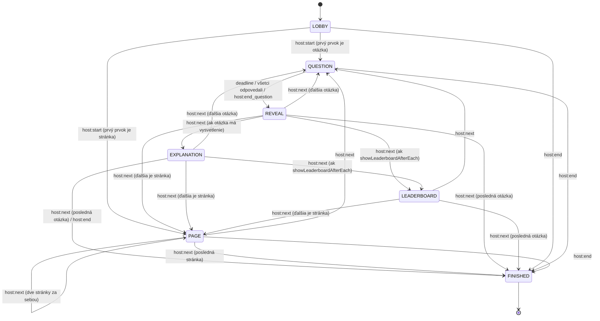

# NexQuiz – Logika a funkcionalita

## Pojmy

| Pojem | Význam |
|---|---|
| **Quiz** | Uložená šablóna: názov, nastavenia, zoradené otázky |
| **Question** | Jedna otázka konkrétneho typu (`single`, `multi`, `order`, `hotspot`, `text`, `music`, `number`) |
| **Page** | Stránka medzi otázkami (nadpis, popis a / alebo obrázok), napr. na oddelenie kategórií. Nie je to otázka: nemá odpovede, body ani časový limit |
| **Explanation** | Voliteľná vysvetľujúca stránka otázky (text, obrázok alebo video, audio klip). Zobrazí sa hneď po vyhodnotení otázky, ešte pred leaderboardom. Patrí k otázke, nie je to samostatná položka kvízu |
| **Game** | Jedno spustenie kvízu. Má PIN, hráčov a stav. Pri štarte sa urobí **snapshot kvízu**, takže úpravy kvízu neovplyvnia bežiacu hru |
| **Host** | Autor a moderátor. Má prístup do editora a ovláda hru |
| **Player** | Účastník hry. Prihlásenie nepotrebuje, stačí PIN + prezývka |
| **PIN** | 6-miestny číselný kód aktívnej hry |

## Roly a prístup

| Sekcia | Route | Prístup |
|---|---|---|
| Landing (template stránka) | `/` | verejná |
| Host | `/host/*` | session (admin heslo) |
| Player | `/play/*` | anonymný token pre konkrétnu hru |

- **Host** sa prihlasuje na landing stránke admin heslom (`ADMIN_PASSWORD`) a dostane session cookie. Má prístup k `/host/*`. Neprihlásený prístup na `/host/*` presmeruje na `/`.
- **Player** zadá PIN na landing stránke alebo naskenuje QR kód, potom prezývku, a dostane token pre túto hru. Má prístup iba k `/play/*`, editor ani host UI nikdy nevidí.
- Player routy nevyžadujú prihlásenie a neobsahujú žiadne host funkcie. Host bundle môže byť lazy-loaded chunk, ktorý sa hráčovi vôbec nestiahne.

---

## Landing (template stránka, `/`)

Vstupná stránka NexQuiz. Obsahuje logo NexQuiz a dve karty: na desktope vedľa seba, na mobile pod sebou s Join kartou na prvom mieste.

**Join** (pripojenie hráča):
- Input na 6-miestny PIN (`inputmode="numeric"`, akceptuje aj vstup s medzerou `123 456`) + tlačidlo **Pripojiť**.
- Overí PIN cez `GET /api/games/:pin/exists`. Pri úspechu presmeruje na `/play?pin=…` (krok prezývky), pri neplatnom alebo neaktívnom PIN zobrazí chybu pod inputom. Rate limit (`429`) alebo nedostupný server zobrazí „Príliš veľa pokusov…“ resp. „Nepodarilo sa spojiť so serverom…“, nie „Hru … sme nenašli“.
- Potvrdený PIN si klient pamätá v pamäti (nie v `localStorage`) 30 s, takže `/play` hneď po presmerovaní `/exists` znova nevolá (jedno volanie na hráča). Reload `/play` a vstup z QR kódu PIN overia znova.

**Login** (prihlásenie hosta):
- Input na heslo + tlačidlo **Prihlásiť** (`POST /api/auth/login`). Pri úspechu presmeruje na `/host`, pri chybe zobrazí „Nesprávne heslo.“
- Ak je session už platná (`GET /api/auth/me`), namiesto formulára sa zobrazí tlačidlo **Pokračovať do host sekcie**.

QR kód vedie priamo na `/play?pin=…`, takže landing stránku hráč z QR kódu preskočí.

## Pätička

- Text `Vytvoril Alnexio`, kde **Alnexio** je odkaz na `https://alnexio.sk` (`target="_blank" rel="noopener"`).
- Zobrazuje sa na landing stránke a na admin stránkach host sekcie (zoznam kvízov, editor, história, výsledky hry).
- Nezobrazuje sa na host game screen počas hry (lobby, otázka, reveal, leaderboard, pódium) ani v player UI, aby neodvádzala pozornosť a nezaberala miesto na projektore a mobile.
- Implementuje ju jeden zdieľaný komponent `AppFooter`.

---

## Host UI

### 1. Zoznam kvízov (`/host`)

- Hlavička na všetkých admin stránkach host sekcie: wordmark NexQuiz (odkaz na `/host`) a **Odhlásiť** (`POST /api/auth/logout`, potom presmerovanie na `/`).
- Zoznam kvízov: názov, počet otázok, posledná úprava.
- Akcie: nový kvíz, upraviť, duplikovať, zmazať, **Spustiť hru**.
- História hier: dátum, kvíz, počet hráčov, víťaz, detail výsledkov.
- Detail výsledkov je na `/host/games/:id/results` (tabuľka poradia s bodmi za každú otázku a odkaz na export CSV `GET /api/games/:id/results?format=csv`). Pri nedokončenej hre (`lobby` / `running`) je v histórii aj odkaz na `/host/games/:pin`.

### 2. Editor kvízu (`/host/quizzes/:id`)

- Ľavý panel obsahuje zoznam otázok a stránok (drag & drop poradie, duplikovať, zmazať, ikona typu). Tlačidlo **+ Otázka / stránka** ponúka typy otázok aj **Stránku bez otázky**. Číslujú sa iba otázky, stránka číslo nemá.
- Stredný panel pri **stránke** má nadpis, popis a obrázok (aspoň jedno z nich), pravý panel jej nastavenia otázky (čas, body) nezobrazuje.
- Stredný panel je editor vybranej otázky:
  - typ otázky (zmena typu vyžaduje potvrdenie, pretože zmaže type-specific dáta; ak otázka ešte nemá žiadne možnosti, ciele, aliasy ani audio, potvrdenie sa nepýta, lebo nie je čo stratiť),
  - text otázky,
  - médium (obrázok alebo video; pri `music` audio, pri `text` navyše voliteľné audio s klipom, pri `hotspot` iba obrázok, pri `number` obrázok alebo video),
  - type-specific editor (pozri Typy otázok).
- Pod type-specific editorom je prepínač **Pridať vysvetľujúcu stránku** (predvolene vypnutý). Po zapnutí sa zobrazí editor vysvetlenia: text, obrázok alebo video a audio s klipom (pozri [Vysvetlenie](#vysvetlenie-explanation)). Vypnutie pri vyplnenom obsahu vyžaduje potvrdenie. Vysvetlenie zostane pri zmene typu otázky aj pri duplikovaní.
- Pravý panel nastavuje otázku: časový limit (5–120 s, default 30), body (default 1000, max. 9999), a pri `multi` a `order` aj režim bodovania (`partial` / `all`).
- Nastavenia kvízu: názov, popis, `speedBonus` (on/off), `showLeaderboardAfterEach` (on/off), `shuffleOptions` (on/off).
- **Autosave** s debounce 1 s posiela `PUT /api/quizzes/:id` s celým kvízom. Validácia (zdieľaná Zod schéma `quizUpdateRequestSchema`) beží pred uložením a chyby sa zobrazia priamo pri otázke. Kým má kvíz chyby, neukladá sa (stav „Neuložené – oprav chyby“); pri odchode z editora sa uloží okamžite a pri neuložených zmenách sa editor opýta, či naozaj odísť. Pred **Spustiť hru** sa kvíz najprv uloží.
- **Náhľad otázky** ukáže, ako otázku uvidí hráč.

### 3. Lobby (`/host/games/:pin`)

- Veľký **PIN** a **QR kód** (`/api/games/:pin/qr`) a pod ním URL (`{base}/play`).
- Živý zoznam pripojených hráčov a počet. Pri hráčovi je akcia **Kick**.
- Tlačidlo **Spustiť**, aktívne pri ≥ 1 hráčovi.
- Voliteľná hudba v lobby.

### 4. Otázka (host screen)

- Text otázky, médium, možnosti (pri choice typoch), poradie a počet otázok (`3 / 15`).
- Odpočet času a počítadlo odpovedí (`12 / 18 odpovedalo`).
- Pri `music` a pri `text` s audiom sa audio prehráva tu (štart, pauza, replay klipu). Hráč so zapnutým zvukom na vlastnom zariadení (pozri Hráč → Prezývka) počuje iba vystrihnutý klip u seba, nezávisle od ovládania hosta.
- Akcia **Ukončiť otázku teraz**.
- Host game screen (všetky fázy) má prepínač **Celá obrazovka** (Fullscreen API, kláves `F`); v prehliadači bez Fullscreen API (iPhone Safari) sa nezobrazí. Obrazovka sa v žiadnej fáze neposúva, dlhé texty sa zmenšujú (DESIGN.md „Responzivita“).

### 4a. Stránka (host screen)

- Zobrazí sa nadpis, popis a obrázok stránky (čo je vyplnené) na celú obrazovku. Bez odpočtu a bez počítadla odpovedí.
- Akcia **Ďalej** vedie na ďalšiu otázku alebo stránku, resp. na koniec hry, ak je stránka posledná.

### 5. Vyhodnotenie otázky (reveal)

Zobrazí sa správna odpoveď a štatistika podľa typu:

- `single` / `multi`: stĺpcový graf počtu hlasov pre každú možnosť, správne možnosti sú zvýraznené.
- `order`: správne poradie a priemerné skóre.
- `hotspot`: obrázok s cieľovou oblasťou a **bodkami všetkých ťukov** hráčov (zelené zásah, červené mimo).
- `text` / `music`: **zoskupené unikátne odpovede** (po normalizácii) s počtom a stavom (✓ uznané / ✗ neuznané). Host môže klikom **prepnúť uznanie**, server prepočíta body všetkým hráčom s touto odpoveďou (pozri Manuálne uznanie).
- `number`: **správne číslo** veľkým písmom s pravidlom (najbližší tip / tolerancia ±X) a pod ním **tipy hráčov zoskupené podľa hodnoty**, od najbližšieho po najvzdialenejší (max. 10 riadkov, zvyšok sa zhrnie): hodnota, o koľko sa líši, počet hráčov a ✓ body / ✗ bez bodov. Host nič neuznáva, výsledok je daný pravidlom.

Akcia **Ďalej** vedie na vysvetlenie (ak ho otázka má), inak na leaderboard, ďalšiu otázku alebo stránku.

### 5a. Vysvetlenie (host screen)

- Iba pri otázke so zapnutou vysvetľujúcou stránkou. Navrchu je štítok „Vysvetlenie · otázka 3“ a text otázky, pod tým text vysvetlenia, obrázok alebo video (spustí sa samo) a `AudioControl` s klipom (spustí sa sám, ak to prehliadač dovolí). Bez odpočtu a bez počítadla odpovedí.
- Akcia **Ďalej** vedie na leaderboard (ak `showLeaderboardAfterEach`), inak na ďalšiu otázku alebo stránku, resp. na koniec hry.

### 6. Leaderboard

- Top 10 hráčov so skóre a zmenou poradia (↑2, ↓1) a body získané v poslednej otázke.

### 7. Koniec hry

- Pódium (top 3) a vedľa neho tabuľka ďalších miest (od 4. miesta), export CSV.
- Výsledky sa zapíšu do histórie.

---

## Player UI

### 1. Vstup do hry

- Hráč zadá PIN na landing stránke (`/`), alebo príde z QR kódu priamo na `/play?pin=123456`.
- `/play` bez PIN presmeruje na `/`.
- Neplatný alebo neaktívny PIN v URL zobrazí chybu s tlačidlom **Späť** (na `/`).
- Ak overenie PIN-u zlyhá kvôli rate limitu (`429`) alebo sieti, hráč vidí príslušnú hlášku s tlačidlami **Skúsiť znova** a **Späť**, nie „Hru … sme nenašli“.
- `RATE_LIMITED` v acku `player:join` zobrazí hlášku pod prezývkou a formulár ostane použiteľný.

### 2. Prezývka

- 1–20 znakov, unikátna v rámci hry (porovnanie bez rozlíšenia veľkosti písmen a diakritiky).
- Hráč si zároveň zostaví **avatar**: telo (5 variantov) a hlavu (5 variantov), voliteľne okuliare, klobúk a fúzy (po 3 variantoch, alebo bez). Výber začína s náhodným telom a hlavou bez doplnkov. Avatar sa posiela v `player:join` a po vstupe sa už nemení.
- Po vstupe sa token uloží do `localStorage` pod kľúčom `nexquiz:{pin}`, aby fungoval reconnect.
- Prepínač **Zvuk a video na tomto zariadení** (predvolene vypnutý) je pre hráča, ktorý nie je pri obrazovke hosta. Zapnutý prehrá u hráča video otázky, audio klip pri `music` a `text` s audiom, video a audio klip vysvetlenia (`GET /api/games/:pin/questions/:index/clip`) a zvuky hry (tick posledných 5 s, gong na konci otázky, fanfára na konci hry). Je to iba UI preferencia klienta (`localStorage` `nexquiz:pref:playerMedia`), server o nej nevie a neposiela nič navyše. Zmeniť sa dá aj na čakacích obrazovkách (lobby, medzi otázkami).

### 3. Čakanie

- „Si v hre, čaká sa na štart“ + prezývka.
- Rovnaká obrazovka sa zobrazí aj medzi otázkami (počas leaderboardu): aktuálne skóre a poradie.

### 3a. Stránka

- Hráč vidí ten istý nadpis, popis a obrázok ako host. Nič neodosiela, ďalej ide hneď, ako host stlačí **Ďalej**.

### 4. Otázka

- Hráč **vidí text otázky** a vstup podľa typu, plus vlastný odpočet (synchronizovaný so serverom).
- Tlačidlo **Odoslať** (pri `single` sa odpoveď odošle hneď ťuknutím).
- Po odoslaní sa zobrazí „Odpoveď odoslaná“ a odpoveď už **nie je možné zmeniť**.
- So zapnutým zvukom a videom: video sa zobrazí namiesto obrázka (spustí sa samo, ak to prehliadač nedovolí so zvukom, spustí sa stlmené) a pri `music` / `text` s audiom je namiesto „🎵 Počúvaj“ prehrávač klipu (▶ / ❚❚, replay, priebeh). Klip sa stiahne pri štarte otázky a spustí sa sám, ak je audio odomknuté (po reloade až po prvom ťuknutí).
- Po uplynutí času sa input zablokuje.

### 5. Výsledok otázky

- Správne / čiastočne / nesprávne, získané body, celkové skóre a poradie.
- Pri `text` / `music` aj vlastná odpoveď a správne odpovede.
- Pri `number` vlastný tip a správne číslo.
- Pri `hotspot` obrázok so správnymi oblasťami a vlastným ťukom (z `correct.targets` a `yourAnswer` v `player:result`).

### 5a. Vysvetlenie

- Hráč vidí ten istý text a obrázok ako host (štítok „Vysvetlenie“). So zapnutým zvukom a videom sa u neho prehrá aj video a vystrihnutý audio klip (`GET /api/games/:pin/questions/:index/clip`). Nič neodosiela, ďalej ide hneď, ako host stlačí **Ďalej**. Výsledok otázky (`result`) a skóre ostávajú v stave.

### 6. Koniec

- Vlastné finálne poradie a skóre, pódium a pod ním tabuľka ďalších miest (od 4. miesta) so zvýrazneným vlastným riadkom. Dáta sú z `game:finished` (`podium` aj celý `ranking` dostávajú všetci).

---

## Typy otázok

Spoločné polia otázky:

```ts
type QuestionBase = {
  id: string;
  type: QuestionType;
  prompt: string;            // text otázky
  media?: { imageId?: string; audioId?: string; videoId?: string };
  timeLimit: number;         // sekundy
  points: number;            // max body, default 1000
  explanation?: Explanation; // voliteľná vysvetľujúca stránka (pozri nižšie)
};
```

`imageId` a `videoId` sa navzájom vylučujú (otázka má obrázok **alebo** video). `videoId` je povolené pri `single`, `multi`, `order`, `text` a `number`; `hotspot` potrebuje statický obrázok a `music` má audio, preto tam `videoId` schéma odmietne. Aj `text` s audiom (pozri `text`) odmietne `videoId`, lebo by sa na obrazovke hosta prehrávali naraz.

Každý scorer vracia `correctness ∈ [0, 1]` (pri `music` súčet váh polí). Výsledné body sa počítajú v sekcii Bodovanie.

### Vysvetlenie (`explanation`)

Voliteľné pole každého typu otázky. Predvolene chýba (prepínač v editore je vypnutý).

```ts
type Explanation = {
  text: string;            // max. 1000 znakov, môže byť prázdny
  media?: { imageId?: string; videoId?: string; audioId?: string };
  clip?: { start: number; duration: number };   // sekundy; práve vtedy, keď je nastavené `media.audioId`
};
```

- Aspoň jedno z `text`, `imageId`, `videoId`, `audioId` musí byť vyplnené (chyba pod kľúčom `explanation.content`).
- `imageId` a `videoId` sa navzájom vylučujú, `audioId` sa nedá kombinovať s `videoId` (prehrávali by sa naraz). Audio a `clip` sa nastavujú iba spolu, klip má rovnaké limity a prehrávač ako pri `music`.
- Zobrazuje sa v stave `EXPLANATION` hneď po `REVEAL` otázky, ešte pred leaderboardom. Nemá časovač, odpovede ani body, do skóre, `game_answers` ani CSV nevstupuje.
- Klientom odchádza až v `explanation:show` (po reveal), **nikdy nie v `question:start`**. Hráči nedostanú `media.audioId`, iba `clip` (rovnako ako pri otázke), hráč so zapnutým zvukom dostane vystrihnutý klip z `/clip`.

### Stránka (`page`, nie otázka)

Prvok `Quiz.questions` bez odpovedí. Nie je súčasťou `QUESTION_TYPES`, volí sa osobitne (`quizItemSchema`, `isPage`).

```ts
type Page = {
  id: string;
  type: "page";
  title: string;          // max. 120 znakov, môže byť prázdny
  description: string;    // max. 1000 znakov, môže byť prázdny
  media?: { imageId?: string };
};
```

- Aspoň jedno z `title`, `description`, `media.imageId` musí byť vyplnené (chyba pod kľúčom `content`).
- Nemá `timeLimit`, `points`, odpovede ani výsledky. Do skóre, histórie odpovedí (`game_answers`) a CSV nevstupuje.
- Zobrazuje sa v stave `PAGE`; `index` stránky je jej pozícia medzi všetkými prvkami kvízu.
- `Quiz.questions` sa volá tak aj naďalej (kvôli uloženým snapshotom hier), no obsahuje otázky aj stránky.
- Číslovanie otázok (`3 / 15`, titulok leaderboardu) stránky nepočíta: `question:start` nesie `number` a `count`, `leaderboard` nesie `number`.
- Kvíz iba zo stránok sa nedá spustiť (`POST /api/games` → `400 INVALID`).

### `single` – výber jednej správnej

```ts
data: { options: { id: string; text: string }[]; correctId: string }   // 2–6 možností
payload: { optionId: string }
```

- Player UI: farebné dlaždice s tvarom a textom, odoslanie ťuknutím.
- Scoring: `optionId === correctId ? 1 : 0`.

### `multi` – multivýber

```ts
data: { options: { id: string; text: string }[]; correctIds: string[]; scoring: "partial" | "all" }
payload: { optionIds: string[] }
```

- Player UI: toggle dlaždice + tlačidlo Odoslať.
- Scoring:
  - `all`: 1, iba ak sa množiny presne zhodujú, inak 0.
  - `partial`: `max(0, (zásahy − 0,5 × nesprávne_vybrané) / correctIds.length)`. Nesprávna voľba stojí polovicu zásahu, nezruší ho celý (napr. 2 správne zo 4: 1 správna + 1 nesprávna = 25 %, všetky štyri = 50 %).

### `order` – zoraď možnosti

```ts
data: { items: { id: string; text: string }[]; scoring: "partial" | "all" }  // items = správne poradie, 3–8 položiek
payload: { order: string[] }
```

- Server pri štarte otázky položky **zamieša** (zaručene nie v správnom poradí) a pošle ich klientom.
- Player UI: drag & drop zoznam (alternatívne šípky ↑↓ pre presnosť na mobile) + Odoslať.
- Scoring:
  - `all`: 1, iba ak sa poradie presne zhoduje.
  - `partial`: normalizovaná Kendall tau, oriezaná na 0. Pri náhodnom poradí je očakávaná hodnota 0, takže nevznikajú zadarmo body.

```ts
export function orderScore(answer: string[], correct: string[]): number {
  const pos = new Map(answer.map((id, i) => [id, i]));
  let concordant = 0, total = 0;
  for (let i = 0; i < correct.length; i++)
    for (let j = i + 1; j < correct.length; j++) {
      total++;
      if (pos.get(correct[i])! < pos.get(correct[j])!) concordant++;
    }
  const tau = (2 * concordant - total) / total;   // -1..1
  return Math.max(0, tau);
}
```

### `hotspot` – označ správne miesto na obrázku

```ts
// súradnice normalizované 0–1 voči šírke/výške obrázka; r je zlomok šírky obrázka
data: { targets: { shape: "circle"; x: number; y: number; r: number }[] }   // ≥ 1 cieľ
payload: { x: number; y: number }
```

- Editor: host klikne do obrázka, čím vytvorí kruh, ťahaním zmení polomer. Cieľov môže byť viac.
- Player UI: obrázok na celú šírku. Ťuknutie položí značku, ktorú je možné pred odoslaním presunúť, potom Odoslať.
- Klient prepočíta súradnice ťuku na rozmery **zobrazeného obrázka** (pri `object-fit: contain` bez letterboxu) a pošle `0–1`.
- Scoring: 1, ak bod padne do niektorého cieľa. Výpočet prebieha v jednotkách šírky, aby kruh nebol pri neštvorcovom obrázku elipsou:

```ts
export function inCircle(p: {x:number;y:number}, t: {x:number;y:number;r:number}, aspect: number /* h / w */) {
  const dx = p.x - t.x;
  const dy = (p.y - t.y) * aspect;
  return dx * dx + dy * dy <= t.r * t.r;
}
```

- Neskôr: polygóny, čiastočné body podľa vzdialenosti.

### `text` – voľná odpoveď

```ts
media?: { audioId?: string }                   // voliteľné audio (doplň text piesne)
data: {
  fields: [{ key: "answer"; label?: string; weight: 1; accepted: string[] }];
  tolerance: "strict" | "normal" | "loose";
  clip?: { start: number; duration: number };  // sekundy; práve vtedy, keď je nastavené `media.audioId`
}
payload: { answers: { answer: string } }   // max 100 znakov
```

- Player UI: jeden textový input + Odoslať. Ak má otázka audio, hráč vidí navyše „🎵 Počúvaj“ (so zapnutým zvukom prehrávač klipu).
- Scoring: `isMatch(input, accepted, tolerance)` vráti 1 alebo 0.
- `accepted` obsahuje aliasy, napríklad `["Bratislava", "BA", "Pressburg"]`.
- **Doplň text piesne**: ku `text` otázke sa dá priložiť audio (`media.audioId` + `data.clip`, rovnaký tvar a prehrávač ako pri `music`). Host nastaví `clip` tak, aby skladba skončila tesne pred chýbajúcim textom; v `accepted` sú chýbajúce slová. Audio a `clip` sa nastavujú iba spolu (schéma odmietne jedno bez druhého) a audio sa nedá kombinovať s `videoId` (obrázok je povolený). Prehráva sa na host screen, hráčom sa `audioId` neposiela (rovnaké pravidlo ako pri `music`), len `clip` ako znamienko, že majú počúvať; hráč so zapnutým zvukom dostane iba vystrihnutý klip. Scoring a fuzzy matching sú nezmenené. Pri zmene typu `music` → `text` sa audio zachová s predvoleným klipom (0 s, 15 s).

### `music` – hudobná otázka

Interne ide o `text` s viacerými poľami + audio. Používa rovnaký scorer.

```ts
media: { audioId: string }
data: {
  clip: { start: number; duration: number };  // sekundy
  fields: [
    { key: "artist"; label: "Interpret"; weight: 0.5; accepted: string[] },
    { key: "title";  label: "Názov skladby"; weight: 0.5; accepted: string[] }
  ];
  tolerance: "strict" | "normal" | "loose";
}
payload: { answers: { artist: string; title: string } }
```

- Audio sa prehráva na host screen, hráči vidia „🎵 Počúvaj“ a dva inputy. Hráč so zapnutým zvukom na vlastnom zariadení dostane namiesto pôvodného súboru iba vystrihnutý klip bez tagov (`GET /api/games/:pin/questions/:index/clip`).
- Každé pole sa vyhodnocuje samostatne: `correctness = Σ weight` pre polia, ktoré sa zhodujú. Pri `points = 1000` je to 500 bodov za interpreta a 500 za názov.
- Váhy polí musia dávať súčet 1 (validácia v editore).

### `number` – tip čísla

Odpoveďou je ľubovoľné číslo (rok, počet, cena, teplota…). Host nastaví správne číslo a **kto získa body**.

```ts
data: {
  answer: number;                      // správne číslo
  mode: "closest" | "tolerance";
  tolerance: number;                   // ≥ 0; používa sa iba v režime "tolerance"
}
payload: { value: number }
```

- Čísla (`answer`, `tolerance`, tip hráča) ležia v intervale ±`LIMITS.number.max` (10¹²) a majú najviac `LIMITS.number.decimals` (3) desatinné miesta. Server ich porovnáva ako celé počty tisícin (`numberUnits`), takže v porovnaní nie je float chyba (`0.1 + 0.2` je presne `0.3`).
- Režimy:
  - `closest` (**najbližší tip**): body dostane hráč s najmenšou vzdialenosťou `|tip − answer|`. Ak je rovnako blízko viac hráčov (aj na opačných stranách správneho čísla), alebo trafili presne, **body dostanú všetci takí hráči**. Ostatní majú 0. Vyhodnotenie je relatívne voči ostatným tipom, preto sa počíta až pri reveal nad všetkými odpoveďami otázky (`scoreQuestion` najprv zistí `closestDistance` a posunie ho scoreru). Jediný hráč, ktorý odpovedal, je vždy „najbližší“, hráč bez odpovede nič nemení.
  - `tolerance` (**tip v tolerancii**): body dostane každý, kto má `|tip − answer| ≤ tolerance` (hranica platí). `tolerance = 0` znamená presný tip. Nezávisí od ostatných hráčov.
- `correctness` je `1` alebo `0` (žiadne čiastočné body). Body = `points × correctness × speedFactor`, speed bonus sa uplatní ako pri ostatných typoch.
- Player UI: jedno pole (`inputmode="decimal"`, čiarka aj bodka, medzery sa ignorujú: `1 998,5`), tlačidlo **±** (decimálna klávesnica na mobile nemá mínus) a nápoveda podľa režimu („Body získa najbližší tip.“ / „…s odchýlkou najviac ±1.“). Neplatný vstup (nie číslo, viac ako 3 desatinné miesta, mimo rozsahu) deaktivuje **Odoslať**. Server neplatnú hodnotu odmietne (`INVALID`).
- `question:start` nesie `mode` a `tolerance` (ide o nápovedu, nie o tajomstvo), **nikdy `answer`**. Správne číslo odchádza až v `question:reveal` / `player:result` (`correct: { type: "number", answer, mode, tolerance }`).
- `question:reveal.stats` = `{ type: "number", guesses: { value, count, hit }[] }`, zoradené podľa vzdialenosti od správneho čísla (nižšia vzdialenosť prvá, pri rovnosti nižšia hodnota). `hit` = tip získal body.
- Override hostom (`host:override`) sa pri `number` nepoužíva, vyhodnotenie určuje iba pravidlo.
- Editor: pole „Správne číslo“, voľba „Najbližší tip“ / „Tip v tolerancii“ s krátkym vysvetlením a pri tolerancii pole „Tolerancia (±)“ (nový `number` začína s `mode = closest`, `tolerance = 1`). Nová otázka nemá správne číslo vyplnené, kým ho host nezadá, je neplatná (rovnako ako `text` bez aliasov).

---

## Fuzzy matching (text, music)

Postup pre každé pole:

1. **Normalizácia** vstupu aj každého aliasu.
2. **Presná zhoda** po normalizácii vedie k uznaniu.
3. **Levenshteinova vzdialenosť** s prahom podľa dĺžky aliasu a tolerancie.
4. **Manuálne uznanie** hostom pri vyhodnotení.

Normalizácia:
- Unicode NFD, odstránenie diakritiky, lowercase.
- `&` sa nahradí `and`.
- Odstráni sa obsah zátvoriek, napríklad `(Remastered 2011)`, a všetko od `feat.` / `ft.` ďalej.
- Odstráni sa úvodný člen `the`.
- Odstráni sa interpunkcia a zredukujú sa medzery.

| Dĺžka aliasu (po normalizácii) | `strict` | `normal` | `loose` |
|---|---|---|---|
| ≤ 4 | 0 | 0 | 1 |
| 5–8 | 0 | 1 | 2 |
| > 8 | 1 | 2 | 3 |

```ts
export function normalize(s: string): string {
  return s
    .normalize("NFD").replace(/\p{Diacritic}/gu, "")
    .toLowerCase()
    .replace(/&/g, " and ")
    .replace(/\(.*?\)|\[.*?\]/g, " ")
    .replace(/\s(feat|ft)\.?\s.*$/, "")
    .replace(/[^\p{L}\p{N}\s]/gu, "")
    .replace(/\s+/g, " ")
    .trim()
    .replace(/^the\s+/, "");   // až po trim, aby fungovalo aj „  The Beatles“ či „(Live) The Beatles“
}

export function levenshtein(a: string, b: string): number {
  const dp = Array.from({ length: b.length + 1 }, (_, i) => i);
  for (let i = 1; i <= a.length; i++) {
    let prev = dp[0]; dp[0] = i;
    for (let j = 1; j <= b.length; j++) {
      const tmp = dp[j];
      dp[j] = Math.min(dp[j] + 1, dp[j - 1] + 1, prev + (a[i - 1] === b[j - 1] ? 0 : 1));
      prev = tmp;
    }
  }
  return dp[b.length];
}

const THRESHOLDS = {
  strict: [0, 0, 1],
  normal: [0, 1, 2],
  loose:  [1, 2, 3],
} as const;

function maxDistance(len: number, t: keyof typeof THRESHOLDS) {
  const [short, mid, long] = THRESHOLDS[t];
  return len <= 4 ? short : len <= 8 ? mid : long;
}

export function isMatch(input: string, accepted: string[], tolerance: keyof typeof THRESHOLDS = "normal") {
  const x = normalize(input);
  if (!x) return false;
  return accepted.some(acc => {
    const y = normalize(acc);
    return x === y || levenshtein(x, y) <= maxDistance(y.length, tolerance);
  });
}
```

Príklady pre `accepted = ["Metallica"]`, tolerancia `normal`:

| Vstup | Výsledok |
|---|---|
| `metallica`, `METALLICA`, `Metalica`, `Metallika` | ✓ |
| `Metalika` (vzdialenosť 2, dĺžka 9) | ✓ |
| `Megadeth` | ✗ |

Unit testy pokrývajú aliasy, diakritiku, `The Beatles` vs `Beatles`, `feat.`, prázdny vstup a veľmi krátke odpovede.

- Levenshtein sa počíta nad Unicode code points (nie UTF-16 jednotkami).
- Alias, ktorý sa normalizuje na prázdny reťazec (napr. `(Intro)`), sa ignoruje, aby nevznikla zhoda s 1-znakovým vstupom pri `loose`.

### Manuálne uznanie (override)

- Počas reveal (a kedykoľvek do konca hry) host vidí pre každé pole zoskupené odpovede podľa normalizovaného tvaru: `{ normalized, examples[], count, accepted }`.
- Host pošle `host:override { questionIndex, fieldKey, normalized, accept }`.
- Server uloží override do `game:{pin}:overrides`, prepočíta body všetkých hráčov s rovnakým normalizovaným tvarom v danom poli a aktualizuje leaderboard. Hráčom pošle nový `player:result`.
- Override má prednosť pred automatickým vyhodnotením.

---

## Bodovanie

```
body = question.points × correctness × speedFactor
speedFactor = quiz.settings.speedBonus ? 1 − 0.5 × min(answeredMs / timeLimitMs, 1) : 1
```

- `answeredMs = receivedAt − questionStartedAt` (časy **servera**).
- Ak `correctness = 0`, výsledok je 0 bez ohľadu na rýchlosť.
- Výpočet je presný (bez floatu): scorery vracajú zlomok `{ num, den }` (Kendall tau, `partial`, váhy polí v tisícinách), `speedFactor = (2T − min(a, T)) / 2T` a body sa počítajú v celých stotinách s jedným zaokrúhlením half-up na konci (`computePointsHundredths` v `shared/scoring/points.ts`). Súčty skóre sa robia v stotinách.
- `correctness` sa pre prenos a `numeric(4,3)` zaokrúhľuje na 3 desatinné miesta.
- **Body sú celé čísla v tisíckach**: otázka má default `1000` bodov, správna odpoveď dá podľa rýchlosti 500–1000 a rozdiel medzi hráčmi je napr. 800, nie 0.8. Body za jednu odpoveď sa zaokrúhľujú half-up na **celé body** (jedno zaokrúhlenie na konci, `computePointsHundredths` vracia násobok 100 stotín), takže skóre aj súčty sú celé čísla. UI ich zobrazuje bez desatinných miest s medzerou po tisícoch (`12 450`, delta `+850`), CSV bez medzier (`12450`).
- Uložené sú ako `numeric(.., 2)` s `.00`: `questions.points` `numeric(6,2)` (max. 9999.99), `game_answers.points` `numeric(8,2)`, `game_players.score` `numeric(10,2)` (200 otázok × 9999 sa nezmestí do 8 číslic).
- Žiadna odpoveď znamená 0 bodov.
- Pri rovnakom skóre rozhoduje súčet `answeredMs` správnych odpovedí (nižší je lepší).

---

## Stavový automat hry



Pravidlá:
- Prechody vykonáva **iba server**, klient posiela len zámer.
- Otázka sa ukončí, keď uplynie čas, keď odpovedali všetci **pripojení** hráči, alebo keď ju host ukončí ručne.
- Neskorý vstup je povolený aj počas hry. Hráč začína s 0 bodmi a zapojí sa od ďalšej otázky (do aktuálnej, ak ešte beží).
- `host:start` je iba prechod `LOBBY → QUESTION` / `PAGE` (podľa prvého prvku kvízu) a vyžaduje ≥ 1 hráča (inak `INVALID`). Ďalšie prvky sa spúšťajú cez `host:next`.
- Stav `PAGE` nemá časovač: hra v ňom čaká na `host:next`. Odpoveď v ňom je `LATE`, `host:end_question` je `INVALID_TRANSITION`. Leaderboard po otázke sa zobrazí ešte pred stránkou.
- Stav `EXPLANATION` ostáva na vyhodnotenej otázke (`currentIndex` sa nemení) a tiež nemá časovač. `host:next` z `REVEAL` doň vedie iba vtedy, keď otázka má `explanation`; bez neho platí pôvodný prechod. Odpoveď v ňom je `LATE`, `host:end_question` je `INVALID_TRANSITION`.
- `host:end` ukončí hru z ktoréhokoľvek bežiaceho stavu (`LOBBY`, `QUESTION`, `REVEAL`, `EXPLANATION`, `LEADERBOARD`, `PAGE`), využíva prechody `* → FINISHED` z diagramu. Neplatný zámer vráti `INVALID_TRANSITION`.
- Všetky operácie jednej hry bežia serializovane pod zámkom hry (in-memory, fáza 1), aby sa napr. timer a `host:end_question` nebili.

### Timery

- Pri `QUESTION` server nastaví `setTimeout(deadline − now + 300 ms grace)`. Grace pokrýva sieťovú latenciu.
- Odpovede prijaté po `deadline + grace` sa zahodia.
- Fáza 1 (jedna inštancia) si vystačí s in-memory timerom. Po reštarte `api` sa timery obnovia z Redisu (`deadline` je uložený) a všetci hráči bežiacich hier sa označia ako odpojení (žiadny socket reštart neprežije), kým sa nevrátia cez `player:rejoin`.
- Fáza 2 (viac inštancií) vyžaduje vlastníka hry cez Redis lock `game:{pin}:owner` alebo delayed job (BullMQ).

---

## Realtime (Socket.IO)

Namespaces:
- `/host`: handshake overí session cookie.
- `/play`: handshake obsahuje `auth: { pin, token? }`.

Každá hra má room `game:{pin}` (všetci) a `game:{pin}:host`. Súkromné správy idú do room `game:{pin}:player:{playerId}` (všetky sockety daného hráča; na rozdiel od `socket.id` funguje aj cez Redis adapter naprieč inštanciami).

### Synchronizácia času

Server posiela `serverNow` a `deadline` (epoch ms). Klient si spočíta `offset = serverNow − Date.now()` a odpočet zobrazuje z `deadline − (Date.now() + offset)`.

### Host → server

| Event | Payload | Ack |
|---|---|---|
| `host:attach` | `{ pin }` | `GameState` |
| `host:start` | – | `ok` |
| `host:next` | – | `ok` |
| `host:end_question` | – | `ok` |
| `host:override` | `{ questionIndex, fieldKey, normalized, accept }` | `ok` |
| `host:kick` | `{ playerId }` | `ok` |
| `host:end` | – | `ok` |

### Player → server

| Event | Payload | Ack |
|---|---|---|
| `player:join` | `{ pin, nickname, avatar? }` | `{ playerId, token }` alebo chyba (`PIN_NOT_FOUND`, `NICK_TAKEN`, `GAME_FINISHED`) |
| `player:rejoin` | `{ pin, token }` | `GameState` (vrátane `hasAnswered`) |
| `player:answer` | `{ questionIndex, payload }` | `{ ok: true }` alebo `{ error: "LATE" \| "ALREADY_ANSWERED" \| "INVALID" }` |

### Server → klienti

| Event | Komu | Payload |
|---|---|---|
| `lobby:players` | host + všetci | `{ players: { id, nickname, avatar, connected }[] }` |
| `page:show` | všetci | `{ index, title, description, media: { imageId? } }`: stránka medzi otázkami (stav `PAGE`) |
| `explanation:show` | všetci | `{ index, number, prompt, text, media: { imageId?, videoId?, audioId? }, clip? }`: vysvetlenie vyhodnotenej otázky (stav `EXPLANATION`); hráči bez `media.audioId` |
| `question:start` | všetci | `{ index, total, number, count, type, prompt, media, options?/items? (zamiešané), fields? (bez accepted), clip? (`music`, `text` s audiom), mode?/tolerance? (`number`), timeLimit, deadline, serverNow }` (hráči bez `media.audioId`) |
| `question:progress` | host | `{ answered, total }` |
| `question:end` | všetci | `{ index }` |
| `question:reveal` | host | `{ correct, stats }` (stats podľa typu: hlasy, ťuky, zoskupené texty, tipy čísel) |
| `player:result` | konkrétny hráč | `{ correctness, points, totalScore, rank, correct, yourAnswer }` |
| `leaderboard` | všetci | `{ index, number, top: { nickname, avatar, score, delta, rankChange }[] }` |
| `game:finished` | všetci | `{ podium, ranking }` |
| `game:state` | pri reconnecte | kompletný snapshot pre danú rolu |
| `player:kicked` | konkrétny hráč | – |

**`question:start` nikdy neobsahuje `correctId`, `correctIds`, správne poradie, `targets` ani `accepted`.**

Presné tvary payloadov sú Zod schémy v `packages/shared/src/schemas/ws.ts`. Doplnenia oproti tabuľke vyššie:

- `index` / `total` sú pozícia medzi všetkými prvkami kvízu (otázky aj stránky) a kľúčujú odpovede; na zobrazenie slúži `number` (1-based číslo otázky) a `count` (počet otázok), stránky sa nepočítajú. `GameState` má pri stave `PAGE` vyplnené `page` (a `question = null`), pri stave `EXPLANATION` vyplnené `explanation` (`question` ostáva otázka, ku ktorej patrí; hráč má aj `result`, host `reveal = null`). Mimo týchto stavov sú `page` a `explanation` `null`.
- `question:start` je discriminated union podľa `type`; `fields` obsahujú iba `{ key, label?, weight }`. Pri `music` a pri `text` s audiom obsahuje aj `clip` (host ho potrebuje na prehranie, nie je to tajomstvo; hráčom slúži ako znamienko „počúvaj“). Server payload pred odoslaním parsuje touto schémou, čím sa odstránia všetky neznáme kľúče (whitelist).
- `media.audioId` dostáva iba host (`/host`). Hráči (`/play`, `question:start` aj `PlayerGameState.question`) ho nedostanú: nahratý súbor si ponecháva tagy (interpret / názov = správna odpoveď `music` otázky, pri `text` s audiom názov piesne) a celú skladbu (pri doplnení textu aj chýbajúci text za klipom), takže jeho id by cez verejné `GET /media/:id` prezradilo odpoveď pred reveal. Hráč so zapnutým zvukom dostane iba klip vystrihnutý na serveri (`GET /api/games/:pin/questions/:index/clip`). `media.videoId` a `imageId` dostávajú všetci: video sa prehrá iba hráčovi so zapnutým zvukom a videom (ostatní ho nestiahnu), hotspot sa ťuká na mobile.
- `question:reveal`: `{ index, correct, stats }`, kde `correct` aj `stats` majú `type`. Skupiny textových odpovedí: `{ normalized, examples[], count, accepted, overridden }` (`overridden` = ikona ✋).
- `player:result`: navyše `index` (aby klient vedel, ku ktorej otázke patrí prepočet po override) a `perField` pri `text` / `music`. `yourAnswer` je `{ type, payload }` alebo `null`.
- `leaderboard`: `{ index, top: { playerId, nickname, avatar, score, delta, rank, rankChange }[] }`, `rankChange > 0` = posun hore.
- `game:finished`: `podium` aj `ranking` sú `{ playerId, nickname, avatar, score, rank }[]`.
- `avatar` (`avatarSchema` v `shared/schemas/avatar.ts`): `{ body: 0–4, head: 0–4, glasses: 0–2 | null, hat: 0–2 | null, mustache: 0–2 | null }` (indexy variantov, kresby sú iba v klientovi). V `player:join` je nepovinný, chýbajúci = `DEFAULT_AVATAR`; hodnota mimo rozsahu vráti `INVALID`. `PlayerGameState` obsahuje vlastný `avatar`.
- `game:state` / ack `host:attach` / ack `player:rejoin`: `HostGameState` resp. `PlayerGameState` (pole `role`). `currentIndex` je `-1` v lobby.
- Acky s chybou majú tvar `{ error: ErrorCode }`, úspešné bez dát `{ ok: true }`.
- Host acky: `INVALID` (neplatný payload alebo príkaz pred `host:attach`), `PIN_NOT_FOUND`, `INVALID_TRANSITION`. `host:override` je povolený po skončení danej otázky až do `FINISHED`, iba pre `text` / `music`, existujúce pole a `normalized`, ktorý je kľúčom niektorej skupiny odpovedí daného poľa (tak ako ho poslal `question:reveal`). Override poslaný v `REVEAL` aktuálnej otázky pošle hostovi nový `question:reveal`, v `LEADERBOARD` iba nový `leaderboard`, v `EXPLANATION` hostovi nič (dotknutí hráči dostanú `player:result` vždy).
- `player:join`: po úspešnom acku server pošle hráčovi aj `game:state`, takže neskorý hráč hneď vidí aktuálnu fázu. Prekročenie limitu (per IP + PIN, pozri [Validácia a limity](#validácia-a-limity)) vráti `RATE_LIMITED`, `pin` v payloade sa musí zhodovať s handshake. Token má tvar `{playerId}.{secret}`, server drží iba jeho SHA-256 hash.
- `player:rejoin` s neplatným alebo vyhodeným tokenom vráti `INVALID_TOKEN`.
- Jeden socket = jeden hráč: `player:join` na sockete, ktorý už patrí hráčovi, a `player:rejoin` za iného hráča vrátia `INVALID` (inak by prvý hráč ostal `connected` bez socketu a blokoval automatické ukončenie otázky).
- `player:answer`: `LATE` = otázka už skončila, `questionIndex < currentIndex` alebo príjem po `deadline + grace`; `ALREADY_ANSWERED` = druhá odpoveď; `INVALID` = iný index, neplatný payload alebo neznámy / vyhodený hráč.
- `host:kick` pošle hráčovi `player:kicked` a jeho sockety opustia rooms hry; prezývka sa uvoľní.

---

## REST API

| Metóda | Cesta | Popis |
|---|---|---|
| POST | `/api/auth/login` | `{ password }` → session cookie |
| POST | `/api/auth/logout` | |
| GET | `/api/auth/me` | stav prihlásenia |
| GET | `/api/quizzes` | zoznam |
| POST | `/api/quizzes` | nový prázdny kvíz; voliteľne `{ title }` (inak `Nový kvíz`) |
| GET | `/api/quizzes/:id` | kvíz vrátane otázok |
| PUT | `/api/quizzes/:id` | uloženie celého kvízu (otázky sa nahradia v transakcii) |
| POST | `/api/quizzes/:id/duplicate` | kópia s novými ID otázok; voliteľne `{ title }` (inak pôvodný názov) |
| DELETE | `/api/quizzes/:id` | |
| POST | `/api/media` | multipart upload → `{ id, url, mime, width?, height?, duration? }` |
| GET | `/media/:id` | súbor |
| POST | `/api/games` | `{ quizId }` → `{ pin, gameId }` (snapshot + Redis init) |
| GET | `/api/games/:pin/qr` | PNG QR kódu s `{base}/play?pin=…` |
| GET | `/api/games/:pin/exists` | verejné, pre join obrazovku |
| GET | `/api/games/:pin/questions/:index/clip` | hráč (`Authorization: Bearer {token}`): audio klip bežiacej otázky alebo jej vysvetlenia (`audio/mpeg`) |
| GET | `/api/games` | história |
| GET | `/api/games/:id/results` | detail; `?format=csv`. `questions` obsahuje iba otázky (bez stránok), ich `index` je pozícia medzi všetkými prvkami; stĺpce CSV `Q1…Qn` číslujú iba otázky |

Host endpointy (všetky okrem `/exists`, `/media/:id`, hráčskeho `/clip`, login, logout a `/auth/me`) vyžadujú session, inak `401 { error: "UNAUTHORIZED" }`.

- Rate limit (`@fastify/rate-limit`, per IP): login 10 / min, `/exists` `EXISTS_RATE_LIMIT_PER_MIN` (default 1000 / min, aby sa celá trieda za jednou IP pripojila naraz), prekročenie vráti `429 { error: "RATE_LIMITED" }`.
- `/exists` vracia vždy `200 { exists }`, aj pre PIN v zlom formáte (`false`).
- `POST /api/media`: MIME podľa zoznamu, obrázky sa overia a zmenšia cez `sharp` (formát sa berie z obsahu súboru), audio cez `music-metadata`. Nepodporovaný typ alebo poškodený súbor → `415 UNSUPPORTED_MEDIA_TYPE`, prekročený limit → `413 PAYLOAD_TOO_LARGE`. Video (`video/mp4`, `video/webm`) sa ukladá bez úprav, limit `MAX_VIDEO_MB`. Odpoveď obsahuje navyše `kind`.
- `GET /media/:id` podporuje `Range` (206), aby sa dalo v audiu a videu pretáčať.
- `GET /api/games/:pin/questions/:index/clip`: token hráča iba v hlavičke `Authorization: Bearer` (nie v URL, aby nebol v logoch). Neplatný alebo vyhodený hráč → `401 INVALID_TOKEN`, neznámy PIN → `404 PIN_NOT_FOUND`. Klip sa vydá iba v stave `QUESTION` pre `currentIndex` a otázku s audiom, resp. v stave `EXPLANATION` pre `currentIndex` a vysvetlenie s audiom (vtedy klip vysvetlenia, nie otázky), inak `404 NOT_FOUND` (pred štartom otázky ani vysvetlenia sa nedá stiahnuť vopred). Server vystrihne úsek `clip.start … clip.start + clip.duration` cez `ffmpeg`, prekóduje ho do MP3 bez metadát (žiadne tagy, nič za klipom) a výsledok drží v pamäti (16 posledných klipov, súbežné požiadavky zdieľajú jeden beh ffmpeg). `Cache-Control: private, no-store`.
- `PUT /api/quizzes/:id` overí, že `imageId` / `audioId` / `videoId` (otázky aj jej vysvetlenia) odkazujú na existujúce médium správneho druhu (inak `400 INVALID`).
- CSV (`?format=csv`): UTF-8 s BOM, stĺpce `rank,nickname,score,Q1…Qn` (body za otázku); bunky začínajúce `= + - @` dostanú prefix `'`.

- DTO sú Zod schémy v `packages/shared/src/schemas/rest.ts`. Chyby majú tvar `{ error: ErrorCode }` (napr. `401 { error: "WRONG_PASSWORD" }` pri logine).
- `GET /api/health` (verejné) vracia `{ status: "ok" | "degraded", db, redis }`, pri výpadku DB alebo Redisu status 503.
- Neznáme GET routy mimo `/api`, `/media` a `/socket.io` vracajú `index.html` (SPA fallback), ostatné `404 { error: "NOT_FOUND" }`.

### Generovanie QR

```ts
const base = config.PUBLIC_URL ?? `${req.protocol}://${req.host}`;   // trustProxy: true
const url = `${base}/play?pin=${pin}`;
reply.type("image/png").send(await QRCode.toBuffer(url, { width: 512, margin: 1 }));
```

### PIN

- 6 náhodných číslic (`crypto.randomInt`), rezervácia cez `SET pin:{pin} {gameId} NX EX ttl`. Pri kolízii sa generuje znova.
- PIN sa uvoľní po `FINISHED` (a vyprší TTL).

---

## Dátový model

### Postgres

```sql
create table media (
  id          uuid primary key default gen_random_uuid(),
  kind        text not null check (kind in ('image','audio','video')),
  mime        text not null,
  size_bytes  int  not null,
  width       int,
  height      int,
  duration_s  numeric(8,2),
  created_at  timestamptz not null default now()
);

create table quizzes (
  id          uuid primary key default gen_random_uuid(),
  title       text not null,
  description text,
  settings    jsonb not null default '{"speedBonus":true,"showLeaderboardAfterEach":true,"shuffleOptions":false}',
  created_at  timestamptz not null default now(),
  updated_at  timestamptz not null default now()
);

create table questions (
  id          uuid primary key default gen_random_uuid(),
  quiz_id     uuid not null references quizzes(id) on delete cascade,
  position    int  not null,
  type        text not null check (type in ('single','multi','order','hotspot','text','music','number','page')),
  prompt      text not null,           -- text otázky; pri `page` jej nadpis
  image_id    uuid references media(id),
  audio_id    uuid references media(id),
  video_id    uuid references media(id),
  time_limit  int  not null default 30 check (time_limit between 5 and 120),
  points      numeric(6,2) not null default 1000,
  data        jsonb not null,           -- validované Zod schémou podľa type; pri `page` `{ "description": "…" }`
  explanation jsonb,                    -- voliteľné vysvetlenie (`explanationSchema`), pri `page` vždy null
  unique (quiz_id, position) deferrable initially deferred
);

create table games (
  id            uuid primary key default gen_random_uuid(),
  quiz_id       uuid references quizzes(id) on delete set null,
  pin           text not null,
  status        text not null check (status in ('lobby','running','finished')),
  quiz_snapshot jsonb not null,
  created_at    timestamptz not null default now(),
  started_at    timestamptz,
  finished_at   timestamptz
);

create table game_players (
  id          uuid primary key default gen_random_uuid(),
  game_id     uuid not null references games(id) on delete cascade,
  nickname    text not null,
  score       numeric(10,2) not null default 0,
  final_rank  int
);

create table game_answers (
  game_id        uuid not null references games(id) on delete cascade,
  question_index int  not null,
  player_id      uuid not null references game_players(id) on delete cascade,
  payload        jsonb not null,
  correctness    numeric(4,3) not null,
  points         numeric(8,2) not null,
  answered_ms    int  not null,
  primary key (game_id, question_index, player_id)
);
```

### Redis kľúče (TTL `GAME_TTL_HOURS`)

| Kľúč | Typ | Obsah |
|---|---|---|
| `pin:{pin}` | string | `gameId` |
| `game:{pin}` | hash | `gameId`, `status`, `state` (`LOBBY`, `QUESTION`, `REVEAL`, `EXPLANATION`, …), `currentIndex`, `questionStartedAt`, `deadline` |
| `game:{pin}:quiz` | string | JSON snapshot kvízu (vrátane správnych odpovedí, iba na serveri) |
| `game:{pin}:shuffle:{idx}` | string | JSON zamiešaného poradia možností/položiek |
| `game:{pin}:players` | hash | `playerId` → `{ nickname, avatar, tokenHash, connected, joinedAt }` (záznam bez `avatar` sa číta ako `DEFAULT_AVATAR`) |
| `game:{pin}:nicks` | set | normalizované prezývky (kontrola unikátnosti) |
| `game:{pin}:scores` | zset | `playerId` → skóre (súčet `results` všetkých otázok, prepočítaný pri každom reveal a override) |
| `game:{pin}:q:{idx}:answers` | hash | `playerId` → `{ payload, receivedAt }` (zápis cez `HSETNX` = iba jedna odpoveď) |
| `game:{pin}:q:{idx}:results` | hash | `playerId` → `{ correctness, points, answeredMs, perField? }` (`answeredMs` kvôli prepočtu po override) |
| `game:{pin}:overrides` | hash | `{idx}:{fieldKey}:{normalized}` → `1` / `0` |

Stránka sa ukladá do `questions` s `type = 'page'`: `prompt` = nadpis, `data = { description }`, `image_id` = obrázok; `time_limit` a `points` majú len hodnoty z defaultov (30 a 0), nepoužívajú sa. Zoznam kvízov počíta iba riadky s `type <> 'page'`.

Persistencia do Postgresu prebieha po každom `REVEAL` (`game_answers`, priebežné `score`) a pri `FINISHED` (`final_rank`, `status`).

- Riadok `games` vznikne pri `POST /api/games` (`status = lobby`), pri prvej otázke sa nastaví `running` a `started_at`.
- `game_players` sa pri každej persistencii upsertujú (ID = `playerId` z Redisu), vyhodení hráči sa odstránia. Po override sa prepíšu odpovede danej otázky aj skóre.
- Výpadok Postgresu hru nezastaví (zdrojom pravdy je Redis), chyba sa zaloguje.
- Po `FINISHED` sa uvoľní iba `pin:{pin}`; ostatné kľúče dobehnú na TTL, aby reconnect videl výsledky. Nová hra s rovnakým PIN staré kľúče najprv zmaže.

---

## Reconnect a odolnosť

- **Hráč:** Socket.IO sa reconnectne automaticky. Pri novom spojení klient pošle `player:rejoin` s tokenom z `localStorage` a server vráti `game:state` (aktuálna fáza, otázka, `hasAnswered`, skóre). Nastáva to typicky pri zamknutí mobilu alebo prepnutí aplikácie.
- **Host:** pri reconnecte pošle `host:attach` a dostane snapshot. Hra beží ďalej, pretože timer je na serveri. Pauza nie je v MVP.
- **Odpojený hráč** zostáva v hre (`connected: false`), nezapočítava sa do „všetci odpovedali“ a na leaderboarde ostáva.
- **Reštart `api` kontajnera:** stav sa načíta z Redisu (AOF) a timery sa obnovia podľa `deadline`. Odpojenia socketov pri vypínaní servera sa nezapisujú (o odpojení všetkých hráčov rozhodne štart, pozri Timery). Overené: reštart počas otázky → host po `host:attach` vidí `QUESTION` s pôvodným `deadline`, hráč sa vráti cez `player:rejoin` a otázku ukončí obnovený timer.

## Validácia a limity

- Všetky payloady prechádzajú Zod schémami z `packages/shared`.
- `optionId` / `optionIds` / `order` musia patriť k aktuálnej otázke. `order` musí byť permutácia.
- Hotspot súradnice musia byť v rozsahu `0 ≤ x, y ≤ 1`.
- `number` odpoveď je JSON číslo (nie reťazec) v rozsahu ±10¹² s max. 3 desatinnými miestami.
- Text má max. 100 znakov na pole a pred uložením sa trimuje.
- Odpoveď sa prijme len pre `currentIndex` a stav `QUESTION`.
- Rate limit `player:join`: max. `JOIN_RATE_LIMIT_PER_MIN` (default 400) / min na **IP + PIN**. Trieda za jedným NAT-om (až ~200 hráčov vrátane opakovaní pri obsadenej prezývke a reloadov) tak naplní jednu hru hneď a iná hra z tej istej siete má vlastný limit. Aby IP + PIN kľúč nedovolil skúšať neobmedzene veľa PIN-ov, `player:join` na neexistujúci PIN (`PIN_NOT_FOUND`) sa počíta aj per IP: po 30 takých pokusoch za minútu dostane IP `RATE_LIMITED` na každý `player:join` až do konca okna.
- `player:answer` 1 na otázku (`HSETNX`). IP = `CF-Connecting-IP`, inak posledná položka `X-Forwarded-For`, inak adresa socketu (rovnaký kľúč používa aj REST rate limit).
- `/exists` max. `EXISTS_RATE_LIMIT_PER_MIN` (default 1000) / min na IP. Kompromis voči hádaniu PIN-u: PIN má 10⁶ kombinácií, jedna IP prejde celý priestor najskôr za ~17 h (pri jednej aktívnej hre nájde PIN v priemere za ~8 h); uhádnutý PIN dovolí iba vstúpiť do hry ako hráč, ktorého host vidí a môže vyhodiť.
- Limity `player:join` sú v pamäti procesu (fixed window, max. 50 000 kľúčov, expirované sa mažú priebežne), rovnako ako store `@fastify/rate-limit`. Pri viacerých inštanciách by platili per inštancia; zdieľaný store (Redis) sa dá doplniť bez zmeny kľúčov.
- Upload: obrázky jpg/png/webp max. 5 MB, audio mp3/ogg/m4a max. 15 MB.
- Editor validuje pred uložením:
  - `single` má 2–6 možností a práve jednu správnu,
  - `multi` má ≥ 1 správnu,
  - `order` má 3–8 položiek,
  - `hotspot` má obrázok a ≥ 1 cieľ,
  - `page` má aspoň jedno z nadpisu, popisu a obrázka (nadpis max. 120, popis max. 1000 znakov),
  - `text` / `music` majú v každom poli ≥ 1 alias,
  - `number` má vyplnené správne číslo (konečné, v rozsahu, max. 3 desatinné miesta) a toleranciu ≥ 0, bez audia,
  - pri `music` je audio a súčet váh polí je 1,
  - `text` s audiom má aj `clip` a nemá video (a naopak `clip` bez audia je neplatný),
  - zapnuté vysvetlenie má aspoň jedno z textu (max. 1000 znakov), obrázka, videa a audia; obrázok alebo video, nie oboje; audio nie s videom a audio práve s `clip`.
- Doplnené limity (v `LIMITS` v `shared/schemas/question.ts`): `multi` má 2–6 možností, text otázky max. 300 znakov, text možnosti max. 120, alias max. 100 znakov a max. 50 aliasov na pole, body 0–9999 s max. 2 desatinnými miestami, váha poľa max. 3 desatinné miesta, klip `start` 0–3600 s a `duration` 1–120 s, hotspot max. 10 cieľov, `number` hodnoty v ±10¹² s max. 3 desatinnými miestami, kvíz max. 200 prvkov (otázok a stránok spolu), ID možností `[A-Za-z0-9_-]{1,64}`, ID otázok UUID.
- `multi` odpoveď musí obsahovať aspoň jednu možnosť a ID sa nesmú opakovať.

---

## Rozsah MVP

**V MVP:**
- Všetkých 7 typov otázok, stránky medzi otázkami, vysvetľujúce stránky otázok, editor s autosave, upload obrázkov a audia.
- Lobby s PIN a QR kódom, join cez mobil aj PC, reconnect.
- Vyhodnotenie s fuzzy matchingom a manuálnym uznaním, speed bonus, leaderboard, pódium.
- História hier, CSV export.
- Docker + Cloudflare Tunnel.

**Neskôr:**
- Používateľské účty (viac hostov).
- Tímový režim.
- Pauza hry.
- Hotspot s polygónmi a čiastočnými bodmi podľa vzdialenosti.
- Obrázky ako možnosti odpovedí.
- Import/export kvízu (JSON), banka otázok.
- Viac `api` inštancií (Redis adapter + distribuované timery).
- Média na S3/MinIO.
