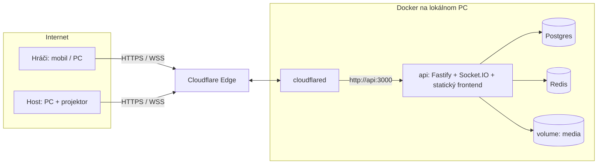

# NexQuiz – Stack

## Cieľ

**NexQuiz** je Kahoot-like kvízová platforma na súkromné použitie.

- **Fáza 1:** celý stack beží v Dockeri na lokálnom PC. Hráči sa pripájajú cez Cloudflare Tunnel (mobil alebo PC, cez PIN alebo QR kód).
- **Fáza 2:** ten istý `docker-compose` sa nasadí na VPS s minimom zmien.

## Technológie

| Vrstva | Technológia | Účel |
|---|---|---|
| Jazyk | **TypeScript** (backend aj frontend) | Zdieľané typy otázok, WS eventov a scoringu |
| Runtime | **Node.js 22** | |
| HTTP | **Fastify** | REST API, servovanie frontendu a médií |
| Realtime | **Socket.IO** (+ `@socket.io/redis-adapter`) | Živá hra: rooms, ack, reconnect; adapter pre viac inštancií neskôr |
| Validácia | **Zod** | Validácia REST/WS payloadov, odvodzovanie TS typov |
| DB | **PostgreSQL 17** | Kvízy, otázky, médiá (metadáta), história hier |
| ORM / migrácie | **Drizzle ORM + drizzle-kit** | Typed queries, SQL migrácie |
| Game state | **Redis 7** | Stav bežiacej hry, odpovede, leaderboard (ZSET), PIN registry, TTL |
| Médiá | Lokálny Docker volume (`/data/media`) | Obrázky, audio a video; neskôr S3/MinIO |
| Spracovanie médií | `sharp` (obrázky), `music-metadata` (dĺžka audia), `ffmpeg` (systémový balík v image) | Rozmery obrázka, resize, dĺžka klipu; vystrihnutie klipu bez tagov pre hráča so zvukom na vlastnom zariadení |
| QR | `qrcode` | Generovanie QR kódu na strane servera |
| Frontend | **Vue 3 + Vite + Vue Router + Pinia** | Jedno SPA s oddelenými časťami `/` (landing), `/host` a `/play` |
| Styling | CSS premenné (design tokens) + Tailwind (voliteľné) | Pozri `DESIGN.md` |
| Drag & drop | `vuedraggable` (SortableJS) | Zoraďovanie otázok v editore aj odpovedí pri `order` |
| Auth (host) | Jedno admin heslo z env → session cookie (`@fastify/secure-session`) | Stačí na súkromné použitie, user účty neskôr |
| Kontajnery | **Docker + Docker Compose** | Celý stack |
| Verejný prístup | **Cloudflare Tunnel** (`cloudflared`) | HTTPS + WebSocket bez otvárania portov |
| Testy | Vitest | Hlavne scoring a fuzzy matching |

## Architektúra



- Jeden `api` kontajner servuje REST, WebSocket, build frontendu a médiá, takže stačí jeden origin a nie je problém s CORS.
- Bežiaca hra žije v Redise a po skončení každej otázky sa výsledky zapíšu do Postgresu.
- Do Postgresu sa ukladá iba trvalé: kvízy, médiá, história hier.

## Štruktúra repozitára (npm workspaces)

```
nexquiz/
├─ apps/
│  ├─ api/
│  │  ├─ src/
│  │  │  ├─ server.ts          # bootstrap Fastify + Socket.IO
│  │  │  ├─ config.ts          # env (Zod)
│  │  │  ├─ db/                # drizzle schema, client
│  │  │  ├─ rest/              # auth, quizzes, media, games
│  │  │  ├─ realtime/          # socket handlery: host, player
│  │  │  ├─ game/              # GameService, state machine, timery
│  │  │  ├─ media/             # MediaStorage (lokálny disk) + spracovanie uploadu + klipy pre hráčov (ffmpeg)
│  │  │  ├─ store/             # Redis repository (+ in-memory fake pre testy)
│  │  │  └─ test/              # testovacie pomocníky (mimo buildu)
│  │  └─ drizzle/              # SQL migrácie
│  └─ web/
│     └─ src/
│        ├─ landing/           # template stránka: Join + Login
│        ├─ host/              # zoznam kvízov, editor, lobby, game screen
│        ├─ play/              # prezývka, otázky, výsledky
│        └─ components/        # vrátane AppHeader, AppFooter
├─ packages/
│  └─ shared/
│     └─ src/
│        ├─ schemas/           # Zod: question types, WS eventy, REST DTO
│        └─ scoring/           # scorery, normalize, isMatch (spúšťa len server)
├─ scripts/
│  ├─ smoke.ts                 # end-to-end smoke test (REST + Socket.IO) proti bežiacemu stacku
│  ├─ loadtest.ts              # záťažový test: 30 otázok, 25 hráčov, meranie odozvy
│  └─ media.ts                 # generované testovacie PNG a MP3
├─ docker-compose.yml
├─ docker-compose.dev.yml
├─ Dockerfile
├─ .env.example
└─ .dockerignore
```

## Docker

### docker-compose.yml

```yaml
name: nexquiz

services:
  api:
    build: .
    env_file: .env
    environment:
      DATABASE_URL: postgres://quiz:${POSTGRES_PASSWORD}@db:5432/quiz
      REDIS_URL: redis://redis:6379
      MEDIA_DIR: /data/media
    volumes:
      - media:/data/media
    ports:
      - "3000:3000"            # lokálny prístup / LAN
    depends_on:
      db: { condition: service_healthy }
      redis: { condition: service_started }
    restart: unless-stopped

  db:
    image: postgres:17-alpine
    environment:
      POSTGRES_USER: quiz
      POSTGRES_PASSWORD: ${POSTGRES_PASSWORD}
      POSTGRES_DB: quiz
    volumes:
      - pgdata:/var/lib/postgresql/data
    healthcheck:
      test: ["CMD-SHELL", "pg_isready -U quiz"]
      interval: 5s
      retries: 10
    restart: unless-stopped

  redis:
    image: redis:7-alpine
    command: ["redis-server", "--appendonly", "yes"]
    volumes:
      - redisdata:/data
    restart: unless-stopped

  # Quick tunnel – náhodná *.trycloudflare.com URL, bez účtu
  tunnel:
    image: cloudflare/cloudflared:latest
    command: tunnel --no-autoupdate --url http://api:3000
    depends_on: [api]
    profiles: [tunnel]

  # Named tunnel – stabilná doména (napr. quiz.tvojadomena.sk)
  tunnel-named:
    image: cloudflare/cloudflared:latest
    command: tunnel --no-autoupdate run --token ${TUNNEL_TOKEN}
    depends_on: [api]
    profiles: [tunnel-named]
    restart: unless-stopped

  # End-to-end smoke test proti BEŽIACEMU api: docker compose --profile smoke run --rm smoke
  # (zámerne bez depends_on: `run` by inak znovu vytvoril bežiaci api kontajner, napr. dev variant)
  smoke:
    image: node:22-alpine
    working_dir: /app
    env_file: .env              # ADMIN_PASSWORD na login
    environment:
      SMOKE_BASE_URL: http://api:3000
    volumes:
      - .:/app
      - smoke_node_modules:/app/node_modules
    command: sh -c "npm install --no-audit --no-fund --loglevel=error && npm run smoke"
    profiles: [smoke]

volumes:
  pgdata:
  redisdata:
  media:
  smoke_node_modules:
```

### docker-compose.dev.yml (hot reload)

```yaml
services:
  api:
    # vlastný tag: image build stage nesmie prepísať produkčný `nexquiz-api`
    image: nexquiz-api-dev
    build:
      target: build
    command: npm run dev        # tsx watch (api) + vite (web, proxy /api, /media a /socket.io na :3000)
    environment:
      NODE_ENV: development
    volumes:
      - .:/app
      - /app/node_modules
    ports:
      - "3000:3000"
      - "5173:5173"
```

```bash
docker compose -f docker-compose.yml -f docker-compose.dev.yml up
```

- Dev variant používa ten istý compose projekt (`nexquiz`), teda tie isté volumes (DB, Redis, médiá), a nahradí kontajner `api`. Frontend je na `http://localhost:5173` (Vite), api na `:3000` neservuje build frontendu.
- Návrat na prod-like stack: `docker compose up -d --build` (znovu vytvorí `api` z produkčného image). `image: nexquiz-api-dev` zaručuje, že dev build neprepíše tag `nexquiz-api`; bez neho by `docker compose up -d` (bez `--build`) po dev behu spustil build-stage image bez `CMD` a kontajner by sa reštartoval v slučke.
- Vite (`server.allowedHosts`) prijíma iba `localhost` a IP adresy, nie hostname `api` ani tunelové domény; tunel smeruje vždy na `api:3000`.

### Dockerfile (monorepo, multi-stage)

```dockerfile
FROM node:22-alpine AS build
# ffmpeg strihá audio klipy pre hráčov so zvukom na vlastnom zariadení (používa ho aj dev kontajner)
RUN apk add --no-cache ffmpeg
WORKDIR /app
COPY package.json package-lock.json ./
COPY apps/api/package.json apps/api/
COPY apps/web/package.json apps/web/
COPY packages/shared/package.json packages/shared/
RUN npm ci
COPY . .
RUN npm run build                  # shared → web → api

FROM node:22-alpine
RUN apk add --no-cache ffmpeg
WORKDIR /app
ENV NODE_ENV=production
COPY package.json package-lock.json ./
COPY apps/api/package.json apps/api/
# apps/web/package.json je tu len kvôli npm ci (lockfile pozná všetky workspaces),
# závislosti webu sa do runtime image neinštalujú.
COPY apps/web/package.json apps/web/
COPY packages/shared/package.json packages/shared/
RUN npm ci --omit=dev --workspace apps/api --include-workspace-root
COPY --from=build /app/packages/shared/dist packages/shared/dist
COPY --from=build /app/apps/api/dist apps/api/dist
COPY --from=build /app/apps/api/drizzle apps/api/drizzle
COPY --from=build /app/apps/web/dist apps/api/public
EXPOSE 3000
# pri štarte spustí migrácie (komentár musí byť na vlastnom riadku, inline komentár rozbije JSON exec formu)
CMD ["node", "apps/api/dist/server.js"]
```

### Poznámky k implementácii

- **`@nexquiz/shared` bez pre-buildu v dev:** `packages/shared/package.json` má v `exports` vlastnú podmienku `@nexquiz/source` → `src/index.ts`, inak `dist/`. TypeScript ju používa cez `customConditions` (typecheck), `tsx` cez `--conditions=@nexquiz/source` (dev api), Vite a Vitest cez alias. Build api (`tsconfig.build.json`) podmienku vypína a číta `dist/*.d.ts`, runtime image číta `dist/index.js`.
- **Deferrable unique na `questions`:** Drizzle nevie deklarovať `deferrable` constraint, preto ho mení vlastná migrácia `apps/api/drizzle/0001_questions_position_deferrable.sql` (vytvorená cez `npm run db:generate -- --custom`).
- **Inline komentáre v `.env`:** Docker Compose pri prázdnej hodnote s komentárom (`PUBLIC_URL=   # …`) odovzdá komentár ako hodnotu. `config.ts` hodnoty začínajúce `#` považuje za prázdne.
- **Vite proxy** smeruje na `http://127.0.0.1:3000` (prepísateľné cez `VITE_API_TARGET`), vite počúva na `0.0.0.0:5173`.
- **`sodium-native` → `sodium-javascript`:** `@fastify/secure-session` potrebuje `sodium-native`, ktorý nemá prebuildy pre Alpine (musl). Root `package.json` ho preto cez `overrides` nahrádza čisto JS implementáciou `sodium-javascript` (rovnaké API, XSalsa20-Poly1305 secretbox). Session kľúč je SHA-256 zo `SESSION_SECRET`. Overené 2026-10: `sodium-native@5.1.0` stále nemá prebuild `linux-arm64-musl` / `linux-x64-musl` (na `node:22-alpine` sa nenačíta). `sodium-javascript` je autormi označený ako WIP; alternatívy sú base image na glibc (`node:22-slim`) bez override alebo vlastná session na `node:crypto` (AES-256-GCM).
- **Socket.IO** beží na tom istom HTTP serveri ako Fastify (`/socket.io`), s `@socket.io/redis-adapter` (pub/sub kópie ioredis klienta). Testy používajú `socket.io-client`.
- **Root devDependencies `tsx` a `socket.io-client`** používajú iba `scripts/smoke.ts` a `scripts/loadtest.ts` (rovnaké verzie ako v `apps/api`, žiadny nový balík). `scripts/` má vlastný `tsconfig.json` a je súčasťou `npm run typecheck`.
- Verzie: TypeScript 6.0 (typescript-eslint zatiaľ nepodporuje TS 7), Vite 8, Vitest 5, Fastify 5, Zod 4, Drizzle ORM 0.45 s driverom `postgres` (postgres.js), Redis klient `ioredis`.

### .env.example

```dotenv
PORT=3000
POSTGRES_PASSWORD=change-me
ADMIN_PASSWORD=change-me            # heslo pre host/editor
SESSION_SECRET=min-32-znakov-nahodny-retazec
PUBLIC_URL=                         # prázdne = odvodí sa z requestu (quick tunnel)
TUNNEL_TOKEN=                       # len pre named tunnel
MAX_IMAGE_MB=5
MAX_AUDIO_MB=15
MAX_VIDEO_MB=50
GAME_TTL_HOURS=12
JOIN_RATE_LIMIT_PER_MIN=400         # player:join na IP + PIN a minútu
EXISTS_RATE_LIMIT_PER_MIN=1000      # GET /api/games/:pin/exists na IP a minútu
```

| Premenná | Kde | Popis |
|---|---|---|
| `PORT` | `.env` | Port api (default 3000) |
| `POSTGRES_PASSWORD` | `.env` | Heslo Postgres používateľa `quiz` (aj pre `DATABASE_URL`) |
| `ADMIN_PASSWORD` | `.env` | Heslo hosta |
| `SESSION_SECRET` | `.env` | Min. **32 znakov**, inak api neštartuje (hodnota z `.env.example` má 29 znakov a treba ju zmeniť) |
| `PUBLIC_URL` | `.env` | Verejná URL pre QR; prázdne = z requestu |
| `TUNNEL_TOKEN` | `.env` | Iba pre `tunnel-named` |
| `MAX_IMAGE_MB`, `MAX_AUDIO_MB`, `MAX_VIDEO_MB` | `.env` | Limity uploadu (default 5 / 15 / 50 MB) |
| `GAME_TTL_HOURS` | `.env` | TTL Redis kľúčov hry |
| `JOIN_RATE_LIMIT_PER_MIN` | `.env` | `player:join` na IP + PIN a minútu (default 400: ~200 hráčov za jedným NAT-om + opakovania a reloady) |
| `EXISTS_RATE_LIMIT_PER_MIN` | `.env` | `GET /api/games/:pin/exists` na IP a minútu (default 1000; kompromis voči hádaniu PIN-u v `LOGIC.md`, Validácia a limity) |
| `DATABASE_URL`, `REDIS_URL`, `MEDIA_DIR` | `docker-compose.yml` | Nastavuje compose |
| `NODE_ENV` | Dockerfile / `docker-compose.dev.yml` | `production` v image, `development` v dev |

## Spustenie

```bash
cp .env.example .env               # vyplniť heslá

# len lokálne / LAN
docker compose up -d --build

# s quick tunelom
docker compose --profile tunnel up -d --build
docker compose logs tunnel | grep -o 'https://[a-z0-9-]*\.trycloudflare\.com'

# s named tunelom
docker compose --profile tunnel-named up -d --build
```

**Dôležité:** host musí otvoriť aplikáciu cez **tunelovú URL**, nie cez `localhost`. QR kód sa generuje z hostname requestu, takže pri `localhost` by obsahoval `localhost`.

### Nastavenie named tunela

1. Pridaj doménu do Cloudflare (stačí free plán).
2. V dashboarde otvor Zero Trust → Networks → Tunnels → Create tunnel (cloudflared) a skopíruj token do `.env` ako `TUNNEL_TOKEN`.
3. Nastav Public hostname: `quiz.tvojadomena.sk` → Service `http://api:3000`.
4. Do `.env` doplň `PUBLIC_URL=https://quiz.tvojadomena.sk`.

## Testy

```bash
npm run typecheck     # shared, api, web (vue-tsc) a scripts/
npm run lint
npm test              # vitest: shared + api (in-memory store, fake persistencia) + web helpery
```

Host má iba Node 18, preto sa príkazy spúšťajú v kontajneri:

```bash
docker run --rm -v "$PWD":/app -v nexquiz_dev_node_modules:/app/node_modules -w /app node:22-alpine \
  sh -c "npm install --no-audit --no-fund && npm run typecheck && npm run lint && npm test"
```

Testy skutočného strihania klipu (`FfmpegClipCutter` v `apps/api/src/media/clips.test.ts`) bežia iba tam, kde je `ffmpeg` v `PATH`, inak sa preskočia. V obraze build stage ho `ffmpeg` má:

```bash
docker build --target build -t nexquiz-test . && docker run --rm nexquiz-test npx vitest run apps/api/src/media
```

### Smoke test (end-to-end)

`scripts/smoke.ts` (`npm run smoke`, spúšťa `tsx`) overí bežiaci stack cez REST a Socket.IO:

- `/api/health`, SPA routy (`/`, `/host`, `/play?pin=…`), 404 pre neznáme `/api`, 401 bez session, zlé heslo, login (cookie `httpOnly`, `sameSite=lax`),
- upload vygenerovaného PNG (hotspot) a MP3 (ticho, ~1 s, `music`), 415 pre nepodporovaný / poškodený súbor, `GET /media/:id` vrátane `Range` (206), pri `music` otázke klip pre hráča (`audio/mpeg` bez ID3, `401` bez tokenu),
- kvíz s jednou otázkou každého zo 6 typov, `400 INVALID` pri neexistujúcom `imageId`,
- hra: `/exists`, QR, `/host` bez session, `host:attach`, join 2 hráčov, `NICK_TAKEN`, `host:kick`, `INVALID_TRANSITION`,
- každá otázka: `question:start` hosta aj hráčov **bez tajomstiev** (`correctId`, `correctIds`, `targets`, `accepted`; hráči bez `audioId`; `order` nie v správnom poradí), `ALREADY_ANSWERED`, `INVALID` (cudzie ID, nie permutácia), `question:progress`, automatické ukončenie, `LATE` (po skončení, starší index, po `deadline` timera), `player:result` (Alica vždy správne, Boris vždy zle), leaderboard,
- `player:rejoin` s tokenom počas otázky (`hasAnswered`), reconnect hosta s `host:attach`, `host:override` pri `text` (prepočet hráča a nový `question:reveal`),
- `FINISHED`: `game:finished`, rejoin po konci, `GAME_FINISHED`, `/exists` false, história (`/api/games`), výsledky a CSV export (BOM, hlavička, body po override).

Na konci kvíz zmaže (hra ostane v histórii, `SMOKE_KEEP_QUIZ=1` ho ponechá). Pri chybe skončí s kódom 1.

```bash
docker compose up -d --build                      # stack musí bežať
docker compose --profile smoke run --rm smoke     # kontajner node:22 v sieti compose, heslo z .env

# alebo priamo (Node 22): proti ľubovoľnej URL
ADMIN_PASSWORD=… SMOKE_BASE_URL=http://localhost:3000 npm run smoke
```

| Premenná | Default | Popis |
|---|---|---|
| `SMOKE_BASE_URL` | `http://localhost:3000` | Base URL api (v kontajneri `http://api:3000`) |
| `SMOKE_ADMIN_PASSWORD` / `ADMIN_PASSWORD` | – | Heslo hosta |
| `SMOKE_KEEP_QUIZ` | – | `1` = kvíz po teste nezmazať |

Proti dev stacku (cez Vite proxy vrátane WebSocketu) treba IP kontajnera, lebo Vite hostname `api` odmietne: `SMOKE_BASE_URL=http://$(docker inspect -f '{{range .NetworkSettings.Networks}}{{.IPAddress}}{{end}}' nexquiz-api-1):5173`.

Login limit (10 / min na IP) dovoľuje ~2 behy smoke testu za minútu (každý beh má vlastnú hru, takže `player:join` limit per IP + PIN ho neobmedzuje).

### Záťažový test

`scripts/loadtest.ts` (`npm run loadtest`) odohrá proti bežiacemu stacku celú hru a zmeria odozvu servera:

- vytvorí kvíz „Záťažový test – 30 otázok“: 30 otázok všetkých 7 typov (aj `text` s audiom, `number` v oboch režimoch) a 2 stránky, s viacerými dlhými zadaniami a možnosťami (na kontrolu rozloženia bez posúvania), vygenerované PNG / MP3, časový limit 5 s,
- pripojí 25 hráčov ako webový klient (`/exists` 1× ako landing alebo QR vstup, potom `player:join` s náhodným avatarom; pri `RATE_LIMITED` skúša znova každých 5 s),
- hráči odpovedajú zmesou správnych, čiastočných, nesprávnych a žiadnych odpovedí v náhodnom čase v rámci limitu, host prechádza otázka → reveal → leaderboard → ďalej ako host UI a pri jednej `text` otázke spraví `host:override`,
- vypíše tabuľku latencií (min / medián / p95 / max): REST volania, `player:join` a `player:answer` acky, `host:next` → `question:start` / `leaderboard` / `game:finished` u hráčov, `question:end` → `player:result`, presnosť timera, chybové acky, odpojenia a zistenia (napr. rate limity), nakoniec poradie z `game:finished`,
- overí, že výsledky v Postgrese obsahujú všetkých hráčov a všetky prijaté odpovede.

Kvíz aj odohraná hra **ostanú** v DB (na kontrolu v editore a vo výsledkoch), skript vypíše ID kvízu, PIN a URL výsledkov.

```bash
docker compose --profile smoke run --rm smoke \
  sh -c "npm install --no-audit --no-fund --loglevel=error && npm run loadtest"
```

| Premenná | Default | Popis |
|---|---|---|
| `LOADTEST_BASE_URL` | `SMOKE_BASE_URL`, inak `http://localhost:3000` | Base URL api |
| `LOADTEST_PUBLIC_URL` | base URL s `api` → `localhost` | Base URL vypísaných odkazov |
| `LOADTEST_ADMIN_PASSWORD` / `SMOKE_ADMIN_PASSWORD` / `ADMIN_PASSWORD` | – | Heslo hosta |
| `LOADTEST_PLAYERS` | `25` | Počet hráčov |
| `LOADTEST_SEED` | náhodný | Zopakuje odpovede a oneskorenia behu |
| `LOADTEST_HOST_PAUSE_MS` | `400` | Pauza hosta na reveal a leaderboarde |
| `LOADTEST_EXISTS_CALLS` | `1` | Volania `/exists` na hráča (web klient volá 1×; 2 = napr. reload `/play`) |
| `LOADTEST_ARRIVAL_MS` | `100` | Odstup príchodu dvoch hráčov (200 hráčov × 100 ms = 20 s, menej = nápor naraz) |
| `LOADTEST_JOIN_RETRY_MS`, `LOADTEST_JOIN_GIVE_UP_MS` | `5000`, `180000` | Opakovanie `player:join` po `RATE_LIMITED` |
| `LOADTEST_KEEP_OPEN` | – | `1` = skončí pred `game:finished`, hru dokončí host v UI |
| `LOADTEST_DISTINCT_IPS` | – | `1` = každý hráč pošle vlastný `CF-Connecting-IP` (hráči z rôznych sietí; funguje iba pri priamom prístupe na api) |

Predvolene sa všetci hráči pripájajú z jednej IP (trieda za NAT-om). Limity `player:join` (400 / min na IP + PIN) a `/exists` (1000 / min na IP) sú nastavené tak, aby sa aj 200 hráčov z jednej IP pripojilo hneď; zistenia v reporte by pri predvolených limitoch nemali hlásiť `RATE_LIMITED`.

## Úložiská

| Úložisko | Čo obsahuje | Trvanlivosť |
|---|---|---|
| Postgres | Kvízy, otázky, metadáta médií, história hier, odpovede | Trvalé (volume `pgdata`) |
| Redis | Stav aktívnej hry, hráči, odpovede aktuálnej otázky, skóre, PIN → game | Dočasné, TTL `GAME_TTL_HOURS`; AOF prežije reštart kontajnera |
| Volume `media` | Súbory obrázkov, audia a videí (`/data/media/{id}.{ext}`) | Trvalé |

Detailná schéma a Redis kľúče sú v `LOGIC.md`.

## Médiá

- Upload ide cez `POST /api/media` (multipart) a na serveri prebehne validácia MIME typu a veľkosti.
- Obrázky sa zmenšia na max. 1920 px cez `sharp`, uloží sa šírka a výška (potrebné pre hotspot).
- Audio (mp3, ogg, m4a) sa uloží spolu s dĺžkou. Klip (start + dĺžka) sa nastavuje v otázke, uložený súbor sa nestrihá.
- Hráč so zapnutým zvukom na vlastnom zariadení dostane klip cez `GET /api/games/:pin/questions/:index/clip`: `ClipService` (`apps/api/src/media/clips.ts`) skopíruje súbor do dočasného adresára (ffmpeg potrebuje seekovateľný vstup, M4A môže mať index na konci), `ffmpeg` z neho vystrihne iba klip a prekóduje ho do MP3 128 kbit/s bez metadát. Výsledok sa drží v pamäti procesu (max. 16 klipov, ide len o cache, nie stav hry) a súbežné požiadavky na ten istý klip zdieľajú jeden beh. `ffmpeg` je v Docker image (oba stage); mimo Dockeru musí byť v `PATH`, inak endpoint vráti `500 INTERNAL` a hráč uvidí „Ukážku sa nepodarilo načítať.“.
- Video (mp4, webm) sa uloží tak ako je (bez transkódovania), s dĺžkou z metadát, ak ju parser zistí (pri MP4 bez zvukovej stopy nie). Kontajner sa overí podľa magic bytes (`ftyp` / EBML) a parserom (`music-metadata`), súbor musí obsahovať video stopu. Limit `MAX_VIDEO_MB`; upload ide celý cez pamäť api, preto veľké limity nezvyšovať bez streamovania.
- Servovanie cez `GET /media/:id` s `Cache-Control: public, max-age=31536000, immutable` (id je UUID).
- Pri prechode na S3/MinIO sa vymení iba implementácia `MediaStorage` interface.

## Bezpečnosť (minimum)

- Host a editor routy chráni session cookie (`httpOnly`, `secure` za tunelom, `sameSite=lax`).
- Login má rate limit (`@fastify/rate-limit`), rovnako aj join do hry (per IP + PIN, neexistujúce PIN-y per IP) a `/exists` (per IP), pozri `LOGIC.md`, Validácia a limity.
- Hráč má iba anonymný token platný pre jednu hru, server drží jeho hash.
- Správne odpovede sa nikdy neposielajú klientovi pred vyhodnotením otázky.
- Všetky WS a REST vstupy prechádzajú cez Zod.
- `trustProxy: true` vo Fastify, aby sa čítali `X-Forwarded-*` hlavičky od cloudflared.
- Kľúč rate limitov (login, `/exists`, `player:join`) nie je `req.ip`: pri `trustProxy: true` je to ľavá, klientom podvrhnuteľná položka `X-Forwarded-For` (Cloudflare k nej iba pripája). Používa sa `CF-Connecting-IP`, inak posledná položka `X-Forwarded-For`, inak adresa socketu (`apps/api/src/clientIp.ts`). Pri priamom prístupe na port `api` mimo tunela si hlavičku môže klient podvrhnúť, preto port `3000` nevystavovať do internetu (LAN je v poriadku).

## Neskoršie nasadenie (fáza 2)

- Na VPS stačí ten istý compose. Ponechá sa `tunnel-named` (bez otvorených portov), alebo sa pridá Caddy/Traefik s Let's Encrypt.
- Pri viacerých `api` inštanciách treba zapnúť Socket.IO Redis adapter a presunúť timery otázok na mechanizmus odolný voči viacerým nodom (pozri `LOGIC.md`, sekcia Timery).
- Zálohy: `pg_dump` cez cron a záloha volume `media`.
- Médiá je možné presunúť na S3/MinIO, Cloudflare R2 alebo Backblaze B2.
